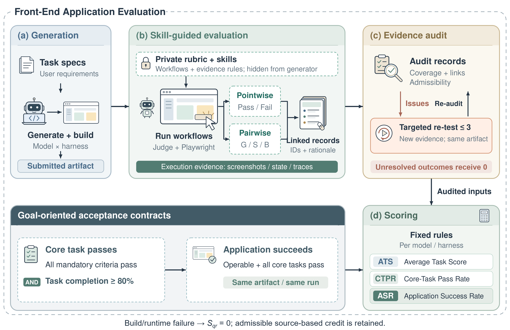
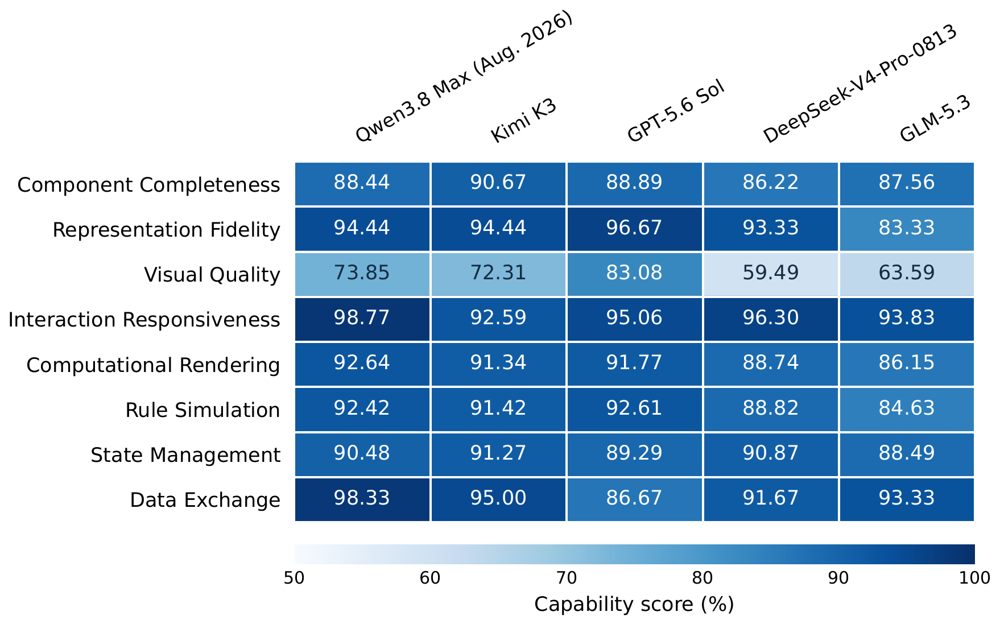
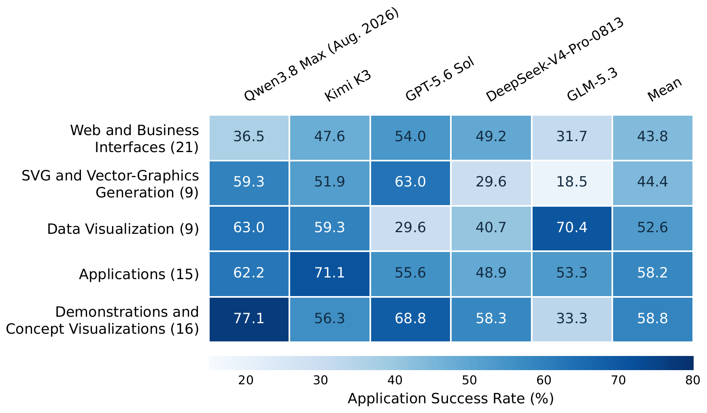
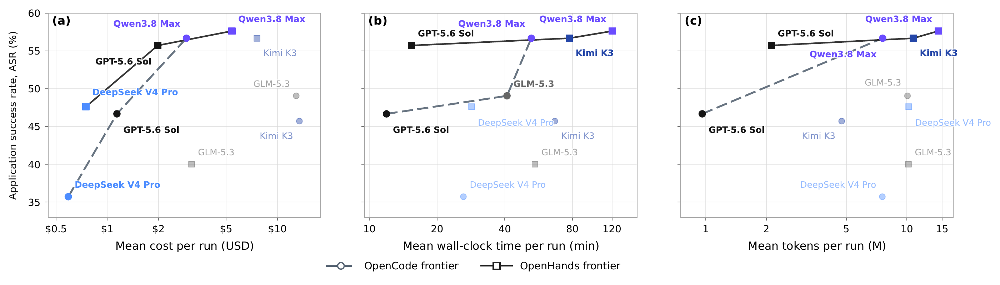

<div align="center">
  
  <h2>JoyFrontBench</h2>
  <p><strong>Evaluating Front-End Coding Agents through Goal-Oriented Acceptance Contracts</strong></p>
  <a href="https://arxiv.org/abs/2611.14952">
    
  </a>
  <a href="https://joyfrontbench.github.io/">
    
  </a>
  <p><strong>English</strong> | <a href="README.zh-CN.md">简体中文</a></p>
</div>

## Overview

**JoyFrontBench** is a benchmark for evaluating how well front-end coding agents
turn user requirements into **complete, functional applications**. It evaluates
application-level success through **goal-oriented acceptance contracts**: a
structured set of core tasks, mandatory criteria, and completion thresholds
derived from each application's primary user workflow.

JoyFrontBench brings together:

- **100 Practitioner-Grounded Development Problems.** JoyFrontBench comprises 100
  front-end development problems derived from interviews with more than 30
  practitioners, covering diverse application scenarios. Each problem includes
  a reviewed specification and evaluation rubric that connects user goals to
  verifiable requirements.
- **Goal-oriented acceptance.** Contracts identify the essential parts of each
  workflow and determine whether they succeed together in a single running application.
- **Execution-grounded evaluation.** A GPT-5.5-based evaluator uses Codex and
  Playwright to inspect running applications and source code, with deterministic
  auditing and scoring.
- **Multi-level performance analysis.** ATS, CTPR, and ASR track task quality,
  core-task completion, and application success, complemented by eight capability scores.
- **Agent-harness comparisons.** OpenCode and OpenHands run under shared generation
  settings, with results reported for each harness separately.

Across the benchmark, **764 rubric tasks and 2,596 atomic criteria** cover visual
presentation, interaction, computation, rule simulation, state management, and
data exchange. The benchmark includes a **30-problem public set** for development
and validation and a **70-problem held-out test set** for main evaluations.

**This repository publishes the 30-problem Public Set** for development,
validation, and evaluation runs.

## Benchmark Design

Each problem starts with a user requirement and its primary workflow. The
goal-oriented acceptance contract connects that workflow to observable tasks
and criteria. Application success requires **all core tasks to pass on the same
operational artifact within a single run**.



OpenCode and OpenHands generate applications with shared settings. The evaluator
collects execution and source evidence through Codex and Playwright, then applies
deterministic auditing before scoring. The contract rules and scoring formulas
are detailed in [Evaluation Method](#evaluation-method).

## Main Results

On the **70-problem test set**, each model–harness–problem combination has
**three independent generations and evaluations**. With OpenHands, the five-model
mean Average Task Score (ATS) is **87.69%**, mean Core-Task Pass Rate (CTPR)
is **80.19%**, and mean Application Success Rate (ASR) is **51.52%**.

| Model | ATS (%) ↑ | CTPR (%) ↑ | OpenHands ASR (%) ↑ | OpenCode ASR (%) ↑ |
| --- | ---: | ---: | ---: | ---: |
| Qwen3.8 Max (Aug. 2026) | 89.56 | **83.02** | **57.62** | **56.67** |
| Kimi K3 | 88.98 | 82.62 | 56.67 | 45.71 |
| GPT-5.6 Sol | **90.53** | 82.34 | 55.71 | 46.67 |
| DeepSeek-V4-Pro-0813 | 85.77 | 80.16 | 47.62 | 35.71 |
| GLM-5.3 | 83.63 | 72.82 | 40.00 | 49.05 |
| **Five-model mean** | 87.69 | 80.19 | 51.52 | 46.76 |

ATS and CTPR use OpenHands results; rows are ordered by OpenHands ASR.
All test-set results average three independent runs within each problem and
then weight problems equally. **ASR is the primary application-success metric.**

**The metrics reveal distinct performance patterns.** GPT-5.6 Sol has the
highest ATS (90.53%) and ranks third in ASR. Qwen3.8 Max (Aug. 2026) leads
OpenHands ASR at 57.62%. The top three ASR point estimates span less than
two percentage points.

**Harness choice affects outcomes and rankings.** GLM-5.3 attains 49.05% ASR
with OpenCode and 40.00% with OpenHands. Models vary in the direction and
magnitude of harness effects. The evaluation characterizes complete
model–harness configurations.

**Application success varies across independent runs.** Under OpenHands, an
average of **48.6%** of model–problem conditions yield both successful and
unsuccessful outcomes across three runs. Similar aggregate ASR values can
reflect different repeatability profiles.

### Capability Scores by Model



Task-weighted capability scores (%) on the 70-problem test set under OpenHands.
Visual Quality averages **70.46%** across models, compared with **95.31%**
for Interaction Responsiveness. The color scale ranges from 50 to 100.

### Performance by Application Category



ASR (%) by application category on the test set under OpenHands.
Parentheses indicate question counts, and the rightmost column shows the
cross-model mean.

### Quality–Efficiency Trade-offs



ASR versus mean generation cost, wall-clock time, and token usage per run on the
test set. Circles and dashed frontiers denote OpenCode; squares and
solid frontiers denote OpenHands. Cost estimates cover normalized generation expenses.

### Application Failures and Evaluation Reliability

On the 30-problem public set, some unsuccessful applications attain high task
scores. Among failed OpenHands runs with valid criterion judgments,
**54.4%** involve mandatory-criterion failures alone, **28.6%** involve
core-task completion failures alone, and **17.1%** involve both mechanisms
in different core tasks.

A financial dashboard scores **90.48% ATS** while exhibiting transfer-input
validation and cross-view state-update failures. An SVG animation scores
**87.50% ATS** with all mandatory criteria passing; two core tasks fall below
the completion threshold. These cases show how contracts identify problems
affecting the primary user goal.

On the public set, automated judgments achieve **83.47%** exact agreement and
Cohen's $\kappa=0.651$ against an adjudicated human reference for **726 pointwise
criteria**. Problem-level scores derived from pointwise judgments have Pearson
correlation **0.807**. This human-reference study evaluates atomic judgments
and corresponding task scores.

## Dataset

The 100 problems originate from interviews with more than 30 practitioners at
JD.com. Requirements were de-identified and rewritten as self-contained
specifications, with internal service dependencies removed. Two reviewers
independently assessed the specifications and rubrics; a third resolved
disagreements. Reference implementations were checked along their primary workflows.

The benchmark has two disjoint splits:

| Split | Problems | Purpose |
| --- | ---: | --- |
| Public set | 30 | Validation, threshold selection, diagnostics, and human-reference analysis |
| Test set | 70 | Main evaluation, model rankings, and cross-harness analysis |

**This repository publishes the 30-problem Public Set**: specifications,
rubrics, core-task policy, reference images, and complete generation and evaluation code.
The 70-problem test set and its rubrics remain held out for the main evaluations.

| Application category | Full benchmark | Public set |
| --- | ---: | ---: |
| Web and Business Interfaces | 30 | 9 |
| Demonstrations and Concept Visualizations | 23 | 7 |
| Applications | 21 | 6 |
| SVG and Vector-Graphics Generation | 13 | 4 |
| Data Visualization | 13 | 4 |
| **Total** | **100** | **30** |

The public set contains **219 rubric tasks**: **204 pointwise tasks with 726
pointwise criteria**, and **15 pairwise tasks with 56 comparison dimensions**.
Pointwise criteria and pairwise comparison dimensions are reported separately.
All 30 problems have pointwise checks; 15 also have visual comparisons supported
by **64 reference scenes and 67 PNG images**.

The [dataset index](data/dataset.json) maps question IDs to candidate-facing
[task specifications](data/tasks/) (e.g., `joyfrontbench-001.md`) and evaluator-facing
[rubrics](data/judge/). IDs such as `frontenjoyai-001` serve the generation
and evaluation interfaces. The [core-task policy](data/core-criteria-policy.json)
and [capability labels](data/capability-dimensions.json) provide the corresponding
acceptance and analysis data.
Pairwise evaluation uses the [reference screenshots](data/references/) at matching
viewports and states; functionality is checked against the running application.

## Evaluation Method

JoyFrontBench connects requirements and acceptance contracts, controlled
application generation, execution-grounded judging, deterministic auditing,
and score aggregation. The coding agent builds from the specification;
evaluation executes the generated artifact and collects evidence for each criterion.

### Goal-Oriented Acceptance Contract

Each problem begins with its primary user workflow. Requirements become tasks
and atomic criteria; each criterion specifies preconditions, actions, expected
observations, and admissible evidence. The contract defines three elements
**before generation**:

1. **Core tasks:** pointwise tasks with at least one mandatory criterion, supporting the primary user goal.
2. **Mandatory criteria:** requirements for key operations, business rules, and specified persistent state.
3. **Completion threshold:** each core task reaches a passing-criteria fraction of $\tau=0.8$.

A core task passes when **all mandatory criteria pass** and its completion
fraction reaches the threshold. **Application success** requires audited build
and runtime checks **and all core tasks to pass on the same artifact in the same run**.
Core tasks and mandatory criteria are specified before generation; the threshold
was selected on the public set and fixed before test-set evaluation.

For a pointwise task, let $A_{qrt}$ denote the passing-criteria fraction of task
$t$ in problem $q$ and run $r$, let $M_{qt}$ be its mandatory criteria, and let
$y_{qrtj}\in\{0,1\}$ be an audited criterion judgment. A core task passes when:

$$
P_{qrt}=\mathbb{I}[A_{qrt}\geq 0.8]\prod_{j\in M_{qt}}y_{qrtj}.
$$

With $B_{qr}$ denoting the audited build-and-runtime outcome and $C_q$ the
set of core tasks, application success is:

$$
S_{qr}=B_{qr}\prod_{t\in C_q}P_{qrt}.
$$

The graded task scores capture partial completion; pairwise reference-image
comparisons also contribute to task scores.

### Execution-Grounded Automated Evaluation

The GPT-5.5 judge uses Codex and Playwright to inspect generated applications:

1. **Build and launch:** run each application in an isolated environment and check operability.
2. **Evidence and judgments:** exercise user flows and collect screenshots,
   application state, files, network records, and interaction traces.
   Pointwise criteria receive Pass/Fail judgments; pairwise tasks receive
   Good/Same/Bad (G/S/B) verdicts relative to reference images.
3. **Deterministic audit:** the Strict Judge validates report completeness,
   identifiers, and admissible evidence. Up to three targeted evidence-gathering
   rounds address audit findings while keeping the generated artifact unchanged.
4. **Deterministic scoring:** fixed acceptance rules compute the metrics from audited judgments.

Generation and evaluation run in separate Docker environments. OpenHands and
OpenCode share outer generation settings and resource limits while retaining
their native agent loops, context management, and stopping conditions.

### Aggregate Metrics

| Metric | Measures | Computation |
| --- | --- | --- |
| **ATS — Average Task Score** | Task-level quality | Equal-weight mean of task scores within a problem. A pointwise task scores its audited passing fraction; a pairwise task scores G/S/B as 1 / 0.5 / 0. |
| **CTPR — Core-Task Pass Rate** | Core-task acceptance | Fraction of a problem's core tasks meeting all mandatory criteria and the $\tau=0.8$ threshold. |
| **ASR — Application Success Rate** | **Primary metric:** application success | Fraction of runs with audited build/runtime success and all core tasks accepted on the same artifact. |

See the [fixed core-task policy](data/core-criteria-policy.json) for the
predefined mandatory criteria. ATS, CTPR, and ASR first average scheduled runs
within each problem, then weight problems equally.

### Capability Scores

Task-weighted **capability scores** are reported for eight dimensions:

| Dimension | What it measures |
| --- | --- |
| Component Completeness (CC) | Presence of required pages, components, controls, and information. |
| Representation Fidelity (RF) | Accuracy of static representations of entities, data, and structures. |
| Visual Quality (VQ) | Coherence of composition, hierarchy, typography, color, and style. |
| Interaction Responsiveness (IR) | Correct responses to clicks, drags, scrolling, and keyboard input. |
| Computational Rendering (CR) | Correct, synchronized updates to derived values and visual output. |
| Rule Simulation (RS) | Correctness of business rules, physical mechanisms, and algorithms. |
| State Management (SM) | Consistency across operations, views, undo/redo, and reloads. |
| Data Exchange (DE) | Correctness of imported, exported, and transferred data. |

Each task has one [capability label](data/capability-dimensions.json). Each score first
averages that task's scores across its scheduled runs, then equally averages all
tasks in the same dimension. The calculation uses the same task scores as ATS.
The scorer computes all eight scores and their coverage from existing task
judgments. See the [scoring specification](src/evaluation/skills/final-score/SKILL.md)
for details.

<details>
<summary>Scoring boundaries and compatibility</summary>

Missing or structurally invalid scheduled runs remain in the denominator with
zero scores. Local audit failures zero the affected items. A build/runtime
failure gives ASR zero; independently supported source-based judgments can
contribute to ATS and CTPR. In the published
[core-task policy](data/core-criteria-policy.json), the machine-readable level
`gating` designates mandatory criteria and follows the existing data format.

</details>

## Quick Start

### 1. Set Up

Use a **Linux x86_64 Docker worker** with Bash, Docker/BuildKit, `jq`, and `pgrep`.
Install **Node.js ≥ 18.19** on the host for batch scheduling and CLI help.
Run the commands from the repository root. Runtime dependencies are installed
inside Docker images, which are built automatically on first use.

```bash
cp .env.example .env
```

Fill in your API key in `.env`:

```dotenv
OPENAI_API_KEY=replace_with_your_api_key
OPENAI_BASE_URL=https://api.openai.com/v1
EVAL_MODEL=gpt-5.5
```

For the default endpoint, set your API key. For another provider,
update the base URL and, if necessary, the evaluator model ID. The evaluator uses
the **Responses API** with image inputs and tool calls. Both stages load `.env`
automatically and use the configured model endpoint.

Choose the candidate model and generation harness:

```bash
MODEL="your-model-id"
HARNESS="opencode"
RUN_ID="quickstart"
export AUTO_EVAL_CODEX_HOME="$PWD/eval-output/codex-home"
```

Set `HARNESS="openhands"` to use OpenHands. The dedicated Codex directory keeps
evaluation state separate from your personal Codex configuration.

### 2. Generate an Application

```bash
./src/scripts/run-benchmark.sh \
  --harness "$HARNESS" --model "$MODEL" --task 001 \
  --run-id "$RUN_ID"
```

The application is saved in
`runs/<harness>/<model>/001/<run-id>/workspace/`, alongside the input prompt,
generation logs, and `metadata.json` containing the effective settings.

### 3. Evaluate the Application

```bash
./src/evaluation/scripts/docker-run.sh eval:pipeline \
  --prompts=data \
  --workspace="runs/$HARNESS/$MODEL/001/$RUN_ID/workspace" \
  --id=frontenjoyai-001 --harness="$HARNESS" --model="$MODEL" \
  --run-id="$RUN_ID" --output-root="eval-output/$RUN_ID"
```

The evaluator selects bundled reference images automatically when needed. To
evaluate an existing application, point `--workspace` to its project directory.
Use a fresh evaluation output directory for each run.

**Model selection:** generation `--model` selects the candidate; evaluation
`--model` records its identity in reports. `EVAL_MODEL` or `--codex-model` selects
the judge.

Open `eval-output/<run-id>/reports/html/eval-summary-report.html` to view the
report. Structured judgments and audit results are in the same `reports/`
directory; browser evidence is under `screenshots/` and `data/`.

### 4. Run the Public Validation Set

Use a separate generation root to keep the quick-start and public validation runs
separate:

```bash
./src/scripts/run-benchmark.sh \
  --harness "$HARNESS" --model "$MODEL" --tasks all \
  --runs-root runs/validation --run-id trial-1

./src/evaluation/scripts/docker-run.sh eval:batch \
  --prompts=data \
  --workspace-root="runs/validation/$HARNESS/$MODEL" \
  --workspace-layout=run-tree \
  --harness="$HARNESS" --model="$MODEL" \
  --expected-runs=1 --jobs=1 \
  --output-root="eval-output/validation/$HARNESS/$MODEL"
```

`eval:batch` evaluates the discovered runs and **automatically computes final
scores**, including eight capability scores. Increase `--jobs` for concurrent evaluations. Each run
uses its own Docker container and evaluator state.

The example schedules one generation per question. For three independent
generations, run generation with `trial-1`, `trial-2`, and `trial-3` under the same
generation root, then evaluate with `--expected-runs=3`. This option defines the
scoring denominator; its default is 3. Subset runs retain the full dataset
denominator in final scoring, so inspect coverage alongside their scores.

Rerunning generation with the same run ID reuses completed runs and resumes
from the last checkpoint. Saved settings apply during resumption, with explicit
CLI options available to override them.

### Generation Options

Both harnesses use the same [default settings](src/generation/common/src/front_generation/defaults.py):

| Setting | Default | Override |
| --- | --- | --- |
| Context budget | 1,000,000 tokens | `--context-tokens` |
| Output per model call | 32,768 tokens | `--max-output-tokens` |
| Reasoning effort | `high` | `--reasoning-effort` |
| Harness-native steps | 500 | `--max-steps` |
| Message protocol | `chat.completions` | `--wire-api` |

The protocol is optional; use `responses` or `anthropic.messages` when required
by your endpoint. Choose limits supported by the model. Step counts follow each
harness's native loop: OpenCode steps or OpenHands iterations.
Use `--timeout-seconds` to set a wall-clock limit.

For multiple models, harnesses, or selected questions:

```bash
./src/scripts/run-benchmark.sh \
  --harnesses opencode,openhands --models model-a,model-b \
  --tasks 001,002 --jobs 2 --run-id compare
```

Generation `--jobs` controls concurrent models. To use separate credentials for
generation and evaluation, select environment files with `FRONT_ENV_FILE` and
`AUTO_EVAL_ENV_FILE`. Exported shell variables override file values; explicit CLI
options take precedence. Use each entrypoint's `--help` for the complete options.

### View and Recompute Results

| Output | Location under the selected evaluation root |
| --- | --- |
| Single-run reports and judgments | `reports/html/`, `reports/md/`, `reports/eval-summary-results.json` |
| Single-run audit result | `reports/eval-judge-results-strict.json` |
| Browser evidence and execution logs | `screenshots/`, `data/`, `logs/` |
| Batch progress and individual evaluations | `batch-state.json`, `batch-summary.json`, `runs/` |
| Batch scores and eight capability scores | `final-score/final-score.json`, `final-score/final-score.md` |

Recompute scores directly from saved judgments:

```bash
./src/evaluation/scripts/docker-run.sh score:final \
  --prompts=data \
  --runs-root="eval-output/validation/$HARNESS/$MODEL" \
  --expected-runs=1 --output-root="eval-output/scores/$HARNESS/$MODEL"
```

Standalone scoring writes `final-score.json` and `final-score.md` directly into
its output root. Keep the scheduled run count consistent with the evaluated batch.

## Repository Structure

```text
data/
  tasks/                       Task specifications
  judge/                       Scoring rubrics
  references/                  Reference images and scene indexes
  dataset.json                 Question index and categories
  core-criteria-policy.json    Core tasks and mandatory criteria
  capability-dimensions.json   Eight-dimension task labels
src/
  generation/                  OpenCode, OpenHands, and shared configuration
  evaluation/                  Browser evaluation, skills, auditing, and scoring
  scripts/                     Unified generation entrypoint and release checks
  data-tools/                  Dataset maintenance tools
```

<details>
<summary>Local checks</summary>

These checks require Node.js and Python 3.12 on the host. Install the evaluation
dependencies before running them:

```bash
npm ci --prefix src/evaluation
node src/evaluation/scripts/cli.mjs references:verify
npm --prefix src/evaluation run check
node --test src/evaluation/tests/*.test.mjs src/data-tools/*.test.mjs
python3.12 -m unittest discover -s src/scripts/tests -v
```

</details>

## Citation

If you use JoyFrontBench in your research, please cite:

```bibtex
@misc{qiao2026joyfrontbench,
  title={JoyFrontBench: Evaluating Front-End Coding Agents through Goal-Oriented Acceptance Contracts},
  author={Xiaoyi Qiao and Yicheng Wang and Jianan Lin and Xiaoyang Ji and Dongyi Lv and Yidan Huang and Shi Suo and Shiying Fan and Nan Duan and Jiaqi Wang},
  year={2026},
  eprint={2611.14952},
  archivePrefix={arXiv},
  url={https://arxiv.org/abs/2611.14952}
}
```

## Acknowledgements

We thank the maintainers and contributors of [Codex](https://github.com/openai/codex),
[OpenHands](https://github.com/OpenHands/OpenHands), and
[OpenCode](https://github.com/anomalyco/opencode) for providing the open-source
frameworks that support our frontend evaluation.

## License

This project is licensed under the [MIT License](LICENSE).
