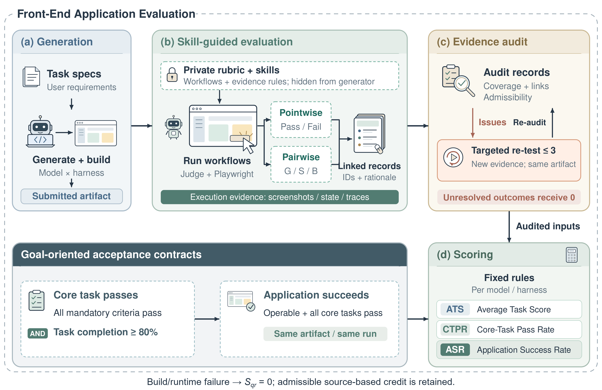
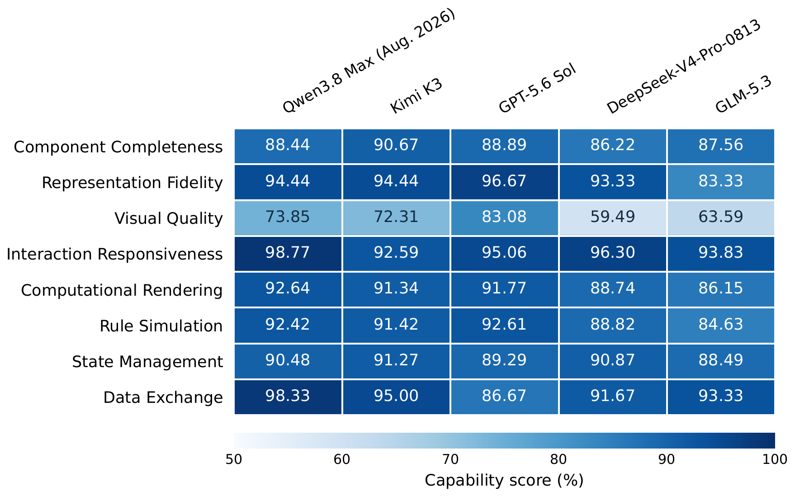
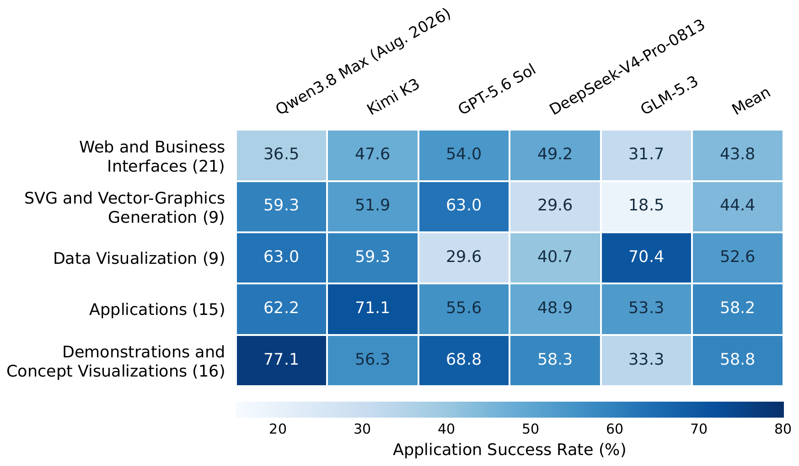
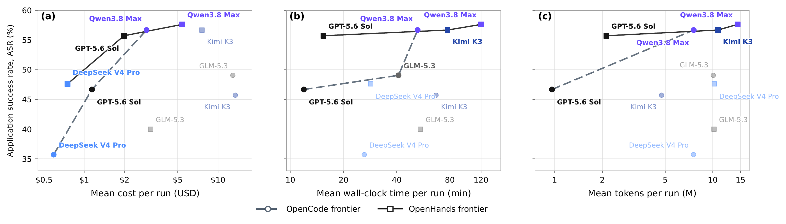

<div align="center">
  
  <h2>JoyFrontBench</h2>
  <p><strong>通过目标导向的验收契约评估前端 Coding Agent</strong></p>
  <a href="https://arxiv.org/abs/2611.14952">
    
  </a>
  <a href="https://joyfrontbench.github.io/">
    
  </a>
  <p><a href="README.md">English</a> | <strong>简体中文</strong></p>
</div>

## 简介

**JoyFrontBench** 是面向前端 Coding Agent 的评测基准，关注 Agent 生成的应用能否完成用户的实际目标。
前端应用通常包含多个相互依赖的功能。例如，搜索、筛选、编辑和保存共同组成用户的工作流程。
JoyFrontBench 同时衡量任务完成质量和主要用户流程能否在同一份应用中顺利运行。

为此，JoyFrontBench 提出**目标导向的验收契约（Goal-Oriented Acceptance Contracts）**：
从应用的主要用户流程出发，在生成前确定核心任务、强制标准与完成度阈值。
基准保留细粒度的任务得分，并衡量完整应用能否通过验收。

JoyFrontBench 包含 **100 道**来自 30 多位从业者需求访谈的前端开发题目，
覆盖 **764 个评测任务和 2,596 个原子标准**。我们在 **5 个 Coding Model**
与 **2 种 Agent Harness（OpenHands、OpenCode）**上开展评测，分析任务质量、
应用成功、重复运行的稳定性以及 Harness 对结果的影响。

**本仓库发布的是 30 题公开集（Public Set）**，用于开发验证和公开题评测。

## 核心设计

- **面向实际需求的 Benchmark。** 题目覆盖网页界面、交互应用、可视化与矢量图形等场景；
  每道题配有经过审查的需求说明和评分细则，将用户目标转化为可验证的要求。
- **目标导向的应用验收。** 契约使用预先确定的核心任务、强制标准和完成度阈值，
  在**同一次运行的同一个生成产物**上判断主要用户目标是否完成，并保留部分完成的任务级评分。
- **多层次实证分析。** ATS、CTPR、ASR 与八维能力分数共同揭示任务表现、应用成功和能力结构；
  双 Harness 比较与重复运行分析展现运行环境和结果波动的影响。



OpenCode 和 OpenHands 使用共享生成参数；GPT-5.5 评测器借助 Codex 和 Playwright
收集执行与源码证据，再由确定性程序审计、计分。契约规则与指标定义详见[评测方法](#评测方法)。

## 主要发现

在 **70 道测试题**上，每个模型、Harness 与题目组合进行 **三次独立生成与评测**。
使用 OpenHands 时，五个模型的平均任务得分（ATS）为 **87.69%**，
平均核心任务通过率（CTPR）为 **80.19%**，平均应用成功率（ASR）为 **51.52%**。

| 模型 | ATS（%）↑ | CTPR（%）↑ | OpenHands ASR（%）↑ | OpenCode ASR（%）↑ |
| --- | ---: | ---: | ---: | ---: |
| Qwen3.8 Max (Aug. 2026) | 89.56 | **83.02** | **57.62** | **56.67** |
| Kimi K3 | 88.98 | 82.62 | 56.67 | 45.71 |
| GPT-5.6 Sol | **90.53** | 82.34 | 55.71 | 46.67 |
| DeepSeek-V4-Pro-0813 | 85.77 | 80.16 | 47.62 | 35.71 |
| GLM-5.3 | 83.63 | 72.82 | 40.00 | 49.05 |
| **五模型平均** | 87.69 | 80.19 | 51.52 | 46.76 |

ATS 和 CTPR 列采用 OpenHands 结果；上表按 OpenHands ASR 排序。
所有结果均为测试集上三次独立运行的均值，并对问题等权聚合。**ASR 是应用成功的主要指标。**

**分层指标揭示应用验收情况。** GPT-5.6 Sol 的 ATS 最高（90.53%），ASR 排名第三；
Qwen3.8 Max (Aug. 2026) 的 OpenHands ASR 最高（57.62%）。
前三名 ASR 的点估计相差 2 个百分点以内。

**Harness 会影响结果与排名。** GLM-5.3 在 OpenCode 下的 ASR 为 49.05%，
高于其在 OpenHands 下的 40.00%；各模型在两种 Harness 间呈现各自的变化幅度和方向。
这里评测的是完整的 Model–Harness 组合。

**应用成功存在运行间波动。** 在 OpenHands 下，平均 **48.6%** 的模型–题目组合
在三次运行中既有成功也有失败。相近的平均 ASR 可能对应不同的重复运行结果分布。

### 能力维度分析



上图展示 70 题测试集、OpenHands 设置下的八项任务加权能力分数。
Visual Quality 的跨模型平均分数为 **70.46%**，低于 Interaction Responsiveness 的 **95.31%**。
图中颜色标尺范围为 50 至 100。

### 不同应用类别的成功率



测试集上、OpenHands 框架下各应用类别的 ASR（%）。
括号内为题目数量，最右列为跨模型均值。

### 质量与生成开销



测试集上，ASR 与每次生成的平均成本、耗时和 Token 用量之间的关系。
圆点与虚线前沿对应 OpenCode，方点与实线前沿对应 OpenHands。
成本统计采用生成阶段的归一化估算值。

### 应用失败机制与评测可靠性

在 30 题公开集上，部分应用呈现高任务得分与失败的验收结果。
在 OpenHands 下具有有效原子判定的失败运行中，单独由强制标准失败导致的占 **54.4%**，
单独由核心任务完成度不足导致的占 **28.6%**，另有 **17.1%** 在不同核心任务上同时出现两类失败。

例如，一项金融看板任务的 ATS 为 **90.48%**，验收发现转账输入校验和跨视图状态更新存在问题；
另一项 SVG 动画任务的 ATS 为 **87.50%**，全部强制标准均已通过，
两个核心任务的完成度低于阈值。这些案例展示了验收契约如何定位影响用户目标实现的具体问题。

在公开集上，独立人工标注与自动评测针对 **726 条 pointwise 标准**的判定
达到 **83.47%** 的完全一致率，Cohen’s $\kappa=0.651$；
基于 pointwise 判定的问题级得分的 Pearson 相关系数为 **0.807**。
这一人类参考对照针对原子判定及相应任务得分开展。

## 数据集

100 道题目源于对京东 30 多位从业者的访谈。需求经过去标识化、移除内部服务依赖，
并改写为自包含题面。两名审查者分别审阅题面和评分细则，第三人裁决分歧；
参考实现沿主要用户流程接受检查。

完整基准分为用途不同、互不重叠的两部分：

| 数据划分 | 题数 | 用途 |
| --- | ---: | --- |
| 公开集（Public Set） | 30 | 验证、阈值选择、诊断及人类参考评估 |
| 测试集（Test Set） | 70 | 主要实验、模型排名与跨框架分析 |

**本仓库发布的是 30 题公开集（Public Set）**，包含题面、评分细则、
核心任务策略、参考图片，以及完整的生成和评测代码。
70 道测试题及其评测标准保留为论文主要实验使用的测试集。

| 应用类别 | 完整基准 | 公开集 |
| --- | ---: | ---: |
| 网页 / 业务界面 | 30 | 9 |
| 演示 / 概念可视化 | 23 | 7 |
| 应用 | 21 | 6 |
| SVG / 矢量图形生成 | 13 | 4 |
| 数据可视化 | 13 | 4 |
| **合计** | **100** | **30** |

公开集包含 **219 个评分任务**：**204 个 pointwise 任务、726 条 pointwise 判据**，以及
**15 个 pairwise 任务、56 个比较维度**。Pointwise 判据与 pairwise 比较维度分别统计。
全部 30 道题均包含 pointwise 检查，其中 15 道题还包含视觉比较，配有
**64 个参考场景、67 张 PNG 图片**。

[题目索引](data/dataset.json) 将 ID 映射到
面向生成模型的[任务说明](data/tasks/)（例如 `joyfrontbench-001.md`）和面向评测器的[评分细则](data/judge/)。
问题 ID（如 `frontenjoyai-001`）用于生成与评测接口；[核心任务策略](data/core-criteria-policy.json)
和[能力维度标注](data/capability-dimensions.json)提供对应的验收与分析数据。
视觉比较使用[参考图片](data/references/)，在相同视口和状态下进行；功能判定则基于被测应用的实际运行表现。

## 评测方法

JoyFrontBench 将需求与验收契约构建、受控应用生成、基于执行证据的评测、确定性审计和指标聚合串联起来。
生成阶段由 Coding Agent 根据需求说明独立完成应用；评测阶段运行生成产物并逐项收集验收证据。

### 目标导向的验收契约

每道题先确定主要用户工作流程，并将需求拆解为任务（Tasks）与原子标准（Atomic Criteria）。
每项原子标准指定前置条件、操作步骤、预期观察结果及允许的证据类型。
验收契约在**应用生成前**确定三个关键要素：

1. **核心任务（Core Tasks）：**包含至少一条强制标准的 pointwise 任务，支撑主要用户目标。
2. **强制标准（Mandatory Criteria）：**检验关键操作的有效性、业务规则及需求规定的持久化状态。
3. **完成度阈值（Completion Threshold）：**核心任务的标准通过比例达到统一阈值 $\tau=0.8$。

核心任务通过需要**全部强制标准通过**，且标准通过比例达到完成度阈值。
**应用成功**要求构建与运行检查通过，且**同一次运行的同一个生成产物通过所有核心任务**。
阈值根据公开集选取，在测试集评测前固定；核心任务与强制标准在应用生成前确定。

对于 pointwise 任务，设 $A_{qrt}$ 为问题 $q$、运行 $r$、任务 $t$ 的标准通过比例，
$M_{qt}$ 为其强制标准集合，$y_{qrtj}\in\{0,1\}$ 表示审计后的标准判定，则核心任务的通过条件为：

$$
P_{qrt}=\mathbb{I}[A_{qrt}\geq 0.8]\prod_{j\in M_{qt}}y_{qrtj}.
$$

设 $B_{qr}$ 表示审计后的构建与运行检查结果，$C_q$ 表示核心任务集合，则应用成功条件为：

$$
S_{qr}=B_{qr}\prod_{t\in C_q}P_{qrt}.
$$

上述规则保留任务完成度，并对应用成功给出明确的验收条件。Pairwise 参考图像比较计入任务得分。

### 基于执行证据的自动评测

评测使用 GPT-5.5 作为 Judge，结合 Codex 和 Playwright 检查生成的应用：

1. **构建与启动：**在隔离环境中构建、运行应用，检查可操作性。
2. **证据收集与判定：**执行用户操作，收集截图、应用状态、文件、网络记录及交互轨迹等证据；
   pointwise 标准采用 Pass/Fail，pairwise 参考图像比较采用 Good/Same/Bad。
3. **确定性审计：**Strict Judge 检查评测记录的完整性、标识符及证据类型；
   按需开展最多三轮针对证据缺口的补充评测，期间保持生成产物原样。
4. **确定性计分：**对通过审计的结果应用固定的验收规则，计算各项指标。

生成和评测在独立 Docker 环境中执行。OpenHands 与 OpenCode 使用统一的外层生成配置与资源限制，
各自保留原生的 Agent Loop、上下文管理和停止机制。

### 评测指标

| 指标 | 衡量内容 | 计算方式 |
| --- | --- | --- |
| **ATS — Average Task Score（平均任务得分）** | 任务级完成质量 | 每题内所有评分任务等权平均；pointwise 任务按审计后通过标准的比例计分，pairwise 任务的 G/S/B 分别计 1 / 0.5 / 0。 |
| **CTPR — Core-Task Pass Rate（核心任务通过率）** | 核心任务验收情况 | 每题内通过验收的核心任务比例，同时满足全部强制标准及 $\tau=0.8$ 完成度阈值。 |
| **ASR — Application Success Rate（应用成功率）** | 完整应用成功情况（主要指标） | 构建与运行通过、同一份应用的全部核心任务共同通过的运行比例。 |

ATS、CTPR 和 ASR 先在每道题的计划运行次数内平均，再对题目等权平均。

### 八项能力维度

基于任务的**能力分数（Capability Scores）**分别报告以下八个维度：

| 维度 | 衡量内容 |
| --- | --- |
| 组件完备 — Component Completeness（CC） | 所需页面、组件、控件与信息是否齐全。 |
| 表征保真 — Representation Fidelity（RF） | 静态画面对实体、数据与结构的表达是否准确。 |
| 视觉品质 — Visual Quality（VQ） | 构图、层级、字体、配色与整体风格是否协调。 |
| 交互响应 — Interaction Responsiveness（IR） | 点击、拖拽、滚动与键盘操作是否正确响应。 |
| 计算渲染 — Computational Rendering（CR） | 派生数值与视觉输出能否正确、同步地更新。 |
| 规则仿真 — Rule Simulation（RS） | 业务规则、物理机制与算法实现是否正确。 |
| 状态管理 — State Management（SM） | 跨操作、视图、撤销重做与刷新时状态是否一致。 |
| 数据交换 — Data Exchange（DE） | 数据导入、导出与传递的内容和格式是否正确。 |

每个评分任务对应一个[能力标签](data/capability-dimensions.json)。能力分数先对该任务的计划运行取平均，
再对同一维度下的全部任务等权平均。任务计分与 ATS 相同，直接按能力维度汇总。
汇总器根据已有判定自动生成八维分数及覆盖情况。
完整定义见[计分说明](src/evaluation/skills/final-score/SKILL.md)。

<details>
<summary>计分边界与兼容性</summary>

缺失或整条结构无效的计划运行保留在分母中并计零；局部审计失败时，受影响项计零。
构建或运行失败时 ASR 为零；有独立证据支持的源码判定可计入 ATS 和 CTPR。
发布的[核心任务策略](data/core-criteria-policy.json)中，机器可读的 `gating` 等级表示强制标准；
这个字段沿用现有评测数据格式。

</details>

## 快速开始

### 1. 准备环境

使用 **Linux x86_64 Docker 工作机**，安装 Bash、Docker/BuildKit、`jq` 和 `pgrep`。
批量调度与 CLI 帮助需要宿主机具备 **Node.js ≥ 18.19**。
以下命令均在仓库根目录执行；运行时依赖安装在 Docker 镜像中，首次运行会自动构建镜像。

```bash
cp .env.example .env
```

在 `.env` 中填入 API key：

```dotenv
OPENAI_API_KEY=replace_with_your_api_key
OPENAI_BASE_URL=https://api.openai.com/v1
EVAL_MODEL=gpt-5.5
```

使用默认地址时，只需修改 key。使用其他服务时，再修改 base URL 和对应的评测模型 ID。
评测器使用支持图片输入与工具调用的 **Responses API**。
生成与评测都会自动读取 `.env`，并使用配置的模型接口。

选择被测模型和生成框架：

```bash
MODEL="your-model-id"
HARNESS="opencode"
RUN_ID="quickstart"
export AUTO_EVAL_CODEX_HOME="$PWD/eval-output/codex-home"
```

将 `HARNESS` 改为 `"openhands"` 即可切换到 OpenHands。
独立的 Codex 目录用于隔离评测状态和个人配置。

### 2. 生成应用

```bash
./src/scripts/run-benchmark.sh \
  --harness "$HARNESS" --model "$MODEL" --task 001 \
  --run-id "$RUN_ID"
```

生成的应用位于 `runs/<harness>/<model>/001/<run-id>/workspace/`。
同级目录保留输入 prompt、生成日志和记录实际参数的 `metadata.json`。

### 3. 评测应用

```bash
./src/evaluation/scripts/docker-run.sh eval:pipeline \
  --prompts=data \
  --workspace="runs/$HARNESS/$MODEL/001/$RUN_ID/workspace" \
  --id=frontenjoyai-001 --harness="$HARNESS" --model="$MODEL" \
  --run-id="$RUN_ID" --output-root="eval-output/$RUN_ID"
```

需要视觉比较时，评测器会自动选择内置参考图片。
也可以通过 `--workspace` 直接评测已有应用。每次评测使用新的输出目录。

**模型参数的区别：** 生成端的 `--model` 选择被测模型；评测端的 `--model` 只记录被测模型身份。
评测模型由 `EVAL_MODEL` 或 `--codex-model` 选择。

打开 `eval-output/<run-id>/reports/html/eval-summary-report.html` 查看报告。
同一 `reports/` 目录中包含结构化判定和审计结果，浏览器证据保存在 `screenshots/` 与 `data/`。

### 4. 运行公开验证集

使用独立的生成目录，将公开集验证与快速开始的单题结果分开：

```bash
./src/scripts/run-benchmark.sh \
  --harness "$HARNESS" --model "$MODEL" --tasks all \
  --runs-root runs/validation --run-id trial-1

./src/evaluation/scripts/docker-run.sh eval:batch \
  --prompts=data \
  --workspace-root="runs/validation/$HARNESS/$MODEL" \
  --workspace-layout=run-tree \
  --harness="$HARNESS" --model="$MODEL" \
  --expected-runs=1 --jobs=1 \
  --output-root="eval-output/validation/$HARNESS/$MODEL"
```

`eval:batch` 会评测发现的运行记录，并**自动计算最终分数和八维能力分数**。
可通过 `--jobs` 增加并发评测数；每次运行使用独立的 Docker 容器和评测状态目录。

示例为每题生成一次。若要生成三次，在同一生成目录下分别使用 `trial-1`、`trial-2` 和 `trial-3`，
然后以 `--expected-runs=3` 评测。该参数决定计划运行分母，默认值为 3。
评测部分题目时，最终汇总仍保留完整题集分母，请结合覆盖情况查看分数。

以相同 run ID 重跑生成命令时，会保留已完成的运行，并从上次进度续跑。
续跑沿用原有参数，也支持显式覆盖。

### 生成参数

两个框架共享同一份[默认配置](src/generation/common/src/front_generation/defaults.py)：

| 参数 | 默认值 | 覆盖选项 |
| --- | --- | --- |
| 上下文预算 | 1,000,000 tokens | `--context-tokens` |
| 单次模型输出 | 32,768 tokens | `--max-output-tokens` |
| 推理强度 | `high` | `--reasoning-effort` |
| 框架原生步数 | 500 | `--max-steps` |
| 消息协议 | `chat.completions` | `--wire-api` |

消息协议是可选参数；按接口需要选择 `responses` 或 `anthropic.messages`，并使用模型支持的预算。
步数按框架原生执行循环统计：OpenCode steps 或 OpenHands iterations。
可用 `--timeout-seconds` 设置整次运行的时间上限。

多模型、双框架或指定题目使用同一个入口：

```bash
./src/scripts/run-benchmark.sh \
  --harnesses opencode,openhands --models model-a,model-b \
  --tasks 001,002 --jobs 2 --run-id compare
```

生成端的 `--jobs` 控制并发模型数。如果生成和评测需要不同的凭据，可分别通过
`FRONT_ENV_FILE` 与 `AUTO_EVAL_ENV_FILE` 选择环境文件。已导出的环境变量优先于文件值，
显式 CLI 参数优先级最高。完整选项可查看各入口的 `--help`。

### 查看与重新汇总结果

| 产物 | 相对于所选评测输出目录的位置 |
| --- | --- |
| 单次评测报告与结构化判定 | `reports/html/`、`reports/md/`、`reports/eval-summary-results.json` |
| 单次评测审计结果 | `reports/eval-judge-results-strict.json` |
| 浏览器证据与执行日志 | `screenshots/`、`data/`、`logs/` |
| 批量进度与各次评测 | `batch-state.json`、`batch-summary.json`、`runs/` |
| 批量总分与八维能力分数 | `final-score/final-score.json`、`final-score/final-score.md` |

从已有判定运行**确定性计分**：

```bash
./src/evaluation/scripts/docker-run.sh score:final \
  --prompts=data \
  --runs-root="eval-output/validation/$HARNESS/$MODEL" \
  --expected-runs=1 --output-root="eval-output/scores/$HARNESS/$MODEL"
```

独立汇总会将 `final-score.json` 和 `final-score.md` 直接写入指定输出目录。
计划运行次数应与被汇总的批次保持一致。

## 目录结构

```text
data/
  tasks/                       任务说明
  judge/                       评分细则
  references/                  参考图片与场景索引
  dataset.json                 题目索引与类别
  core-criteria-policy.json    核心任务与强制标准
  capability-dimensions.json   八维能力标签
src/
  generation/                  OpenCode、OpenHands 与共享配置
  evaluation/                  浏览器评测、Skill、审计与计分
  scripts/                     统一生成入口与发布检查
  data-tools/                  题集维护工具
```

<details>
<summary>本地检查命令</summary>

以下检查需要宿主机安装 Node.js 和 Python 3.12，并先安装评测依赖：

```bash
npm ci --prefix src/evaluation
node src/evaluation/scripts/cli.mjs references:verify
npm --prefix src/evaluation run check
node --test src/evaluation/tests/*.test.mjs src/data-tools/*.test.mjs
python3.12 -m unittest discover -s src/scripts/tests -v
```

</details>

## 引用

如果 JoyFrontBench 对你的研究有帮助，欢迎引用：

```bibtex
@misc{qiao2026joyfrontbench,
  title={JoyFrontBench: Evaluating Front-End Coding Agents through Goal-Oriented Acceptance Contracts},
  author={Xiaoyi Qiao and Yicheng Wang and Jianan Lin and Xiaoyang Ji and Dongyi Lv and Yidan Huang and Shi Suo and Shiying Fan and Nan Duan and Jiaqi Wang},
  year={2026},
  eprint={2611.14952},
  archivePrefix={arXiv},
  url={https://arxiv.org/abs/2611.14952}
}
```

## 致谢

感谢 [Codex](https://github.com/openai/codex)、[OpenHands](https://github.com/OpenHands/OpenHands) 和
[OpenCode](https://github.com/anomalyco/opencode) 的维护者与贡献者，
为我们的前端评测提供开源框架支持。

## 许可证

本项目采用 [MIT 协议](LICENSE)。
